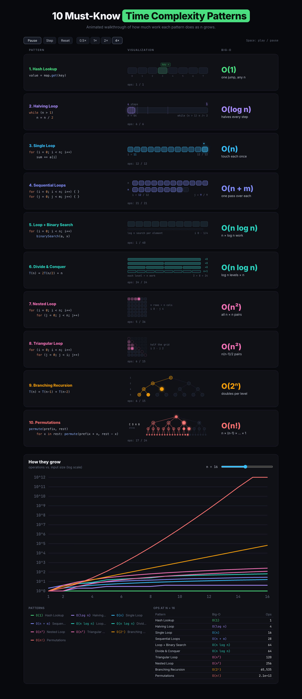

# Complexity Patterns

An animated, interactive board of the **10 must-know time complexity patterns**, from `O(1)` to `O(n!)`, built with Angular.

Each pattern gets its code snippet, a looping animation of the work it performs, a live operation counter and its Big-O class. Below the board, a growth chart plots all ten cost functions side by side on a log scale.



## The patterns

| #  | Pattern              | Code                                   | Big-O        | Intuition               |
|----|----------------------|----------------------------------------|--------------|-------------------------|
| 1  | Hash Lookup          | `value = map.get(key)`                 | `O(1)`       | one jump, any n         |
| 2  | Halving Loop         | `while (n > 1) n = n / 2`              | `O(log n)`   | halves every step       |
| 3  | Single Loop          | `for (i < n) sum += a[i]`              | `O(n)`       | touch each once         |
| 4  | Sequential Loops     | `for (i < n) {}` then `for (j < m) {}` | `O(n + m)`   | one pass over each      |
| 5  | Loop + Binary Search | `for (i < n) binarySearch(a, x)`       | `O(n log n)` | n × log n work          |
| 6  | Divide & Conquer     | `T(n) = 2T(n/2) + n`                   | `O(n log n)` | log n levels × n        |
| 7  | Nested Loop          | `for (i < n) for (j < n)`              | `O(n²)`      | all n × n pairs         |
| 8  | Triangular Loop      | `for (i < n) for (j < i)`              | `O(n²)`      | n(n-1)/2 pairs          |
| 9  | Branching Recursion  | `T(n) = T(n-1) + T(n-2)`               | `O(2ⁿ)`      | doubles per level       |
| 10 | Permutations         | `permute(prefix, rest)`                | `O(n!)`      | n × (n-1) × … × 1       |

## Features

- **Animated visualizations.** Each of the ten patterns has its own animation: buckets, halving bars, cursors, grids, merge levels and recursion or permutation trees.
- **Live operation counters.** Every row shows `ops: X / total` for its input size. The total matches the pattern's cost function exactly.
- **Playback controls.** Play/pause, single step, reset and speeds of 0.5×, 1×, 2× and 4×. Press **Space** on the board to toggle playback.
- **Growth chart.** A pure SVG chart of operations × n for every pattern on a log scale.
  - A slider sets n from 2 to 32.
  - Hovering or focusing a legend item highlights that curve.
  - A table lists the exact operation counts.
- **Accessible.** Each animation has `role="img"` with a live `aria-label`, and the controls carry `aria-pressed` state. Playback starts paused when the user prefers reduced motion.
- **Responsive.** Below 720px the columns stack into a single column.

## Tech stack

- Angular 22: standalone components, signals, zoneless change detection, OnPush.
- TypeScript 6 and SCSS.
- Vitest for unit tests, through the Angular CLI `unit-test` builder.
- No runtime dependencies beyond Angular. Every chart and animation is hand-written SVG or CSS.

## Getting started

Requirements: Node.js 20.19+ (or 22.12+/24+) and npm.

```bash
npm install
npm start            # http://localhost:4200
```

Other commands:

```bash
npm run build                 # production build in dist/
npx ng test --watch=false     # run the unit tests once
```

## Project structure

```
src/app/
├── core/                     # shared contracts
│   ├── patterns.model.ts     # PatternDef, PatternViz contract
│   ├── patterns.data.ts      # the 10 patterns (code, Big-O, tone, animation size)
│   ├── complexity.ts         # costFor(id, n): operation count per pattern
│   ├── animation-clock.ts    # global tick driving every animation
│   └── viz-registry.ts       # pattern id -> visualization component
└── features/
    ├── board/                # rows, code highlighting, controls, viz host
    ├── growth-chart/         # SVG growth chart, legend and ops table
    └── viz/
        ├── linear/           # patterns 1-4
        ├── grid/             # patterns 5-8
        └── tree/             # patterns 9-10
```

### How the animations work

One `AnimationClock` emits a global `tick`. Every visualization implements the `PatternViz` contract:

- **Inputs:** `step` (the tick) and `color` (the pattern's tone).
- **Output:** `opsChange`.

The frame is a pure function of `step % cycleLength`, so the animations are deterministic and loop forever. In each cycle the operation counter starts at `0`, never decreases and ends at exactly `costFor(id, n)`. See [`CONTRACTS.md`](CONTRACTS.md) for the full rules.

## License

[MIT](LICENSE) © Rubens Rudio
